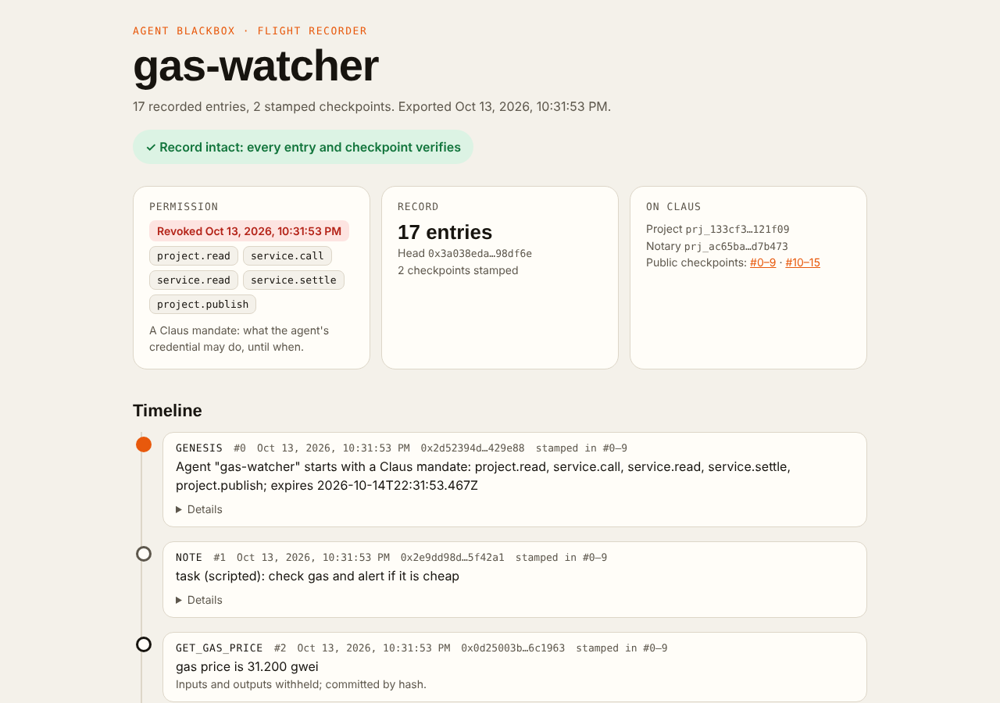

# Agent Blackbox

**A flight recorder for AI agents.** It records what an agent was allowed to do, every action it took, and the moment its access was taken away, in a log that anyone can check and nobody can quietly rewrite.



AI agents are starting to act for people: trading, posting, managing wallets. When something goes wrong, the questions are always the same. What was it allowed to do? What did it actually do? When was it stopped? Today the answers come from logs the operator controls and can edit. Agent Blackbox makes them verifiable.

It is built on [Claus Network](https://claus.si/docs), which provides the pieces this needs:

- **Scoped, expiring, revocable agent access.** The agent works under a Claus *mandate*: a credential limited to named scopes and an expiry, which the owner can revoke at any time.
- **A notary with public provenance.** A free Claus public-data service stamps each checkpoint of the log. Claus records when it was ordered and delivered, and publishes the stamped result with its provenance.
- **A path on-chain.** Each stamp already includes the exact bytes for an Ethereum signal feed, and `contracts/AgentBlackboxModule.sol` is the evaluator that would check them (see [Going on-chain](#going-on-chain)).

## How it works

```
 agent ──tool call──▶ blackbox log (hash-chained JSONL, one line per action)
                          │
                          │  every N entries / hour
                          ▼
                   checkpoint = Merkle root + head of the new entries
                          │
                          ▼  ordered with the agent's own Claus credential
               ┌──────────────────────┐
               │ Blackbox Notary       │  free Claus service "blackbox.checkpoint.v1"
               │ (separate project)    │  stamps time, adds the on-chain encoding
               └──────────────────────┘
                          │
                          ▼  buyer accepts and publishes the result
           public Claus result with provenance  ──▶  anyone can verify the log against it
```

1. **Genesis.** `setup` creates two Claus projects: the notary, and the agent's home project with a mandate for the agent (scopes and expiry). The log's first entry records that mandate.
2. **Recording.** Wrap any async tool with `box.wrapTool(name, fn)`. Each call becomes an entry with a short public summary and a hash commitment to the full input and output, linked to the previous entry by hash. Failures are recorded too.
3. **Checkpoints.** `checkpoint` takes the entries since the last one, computes a Merkle root, and orders a stamp from the notary using the agent's own credential. The stamped result is accepted, published on Claus, and noted in the log.
4. **Revocation.** `revoke` revokes the mandate on Claus, proves the agent's credential no longer works, records the revocation, and stamps a final checkpoint as the owner.
5. **Verification.** `verify` re-checks the whole chain and every checkpoint against its public copy on Claus. The [viewer](viewer/index.html) does the same in the browser, with nothing but WebCrypto.

Change, delete or reorder any entry that was already stamped, and the log no longer matches the public stamp.

## Quick start

Requires Node 20.10+.

```sh
npm install
node bin/blackbox.mjs setup --agent gas-watcher --hours 24   # Claus projects, notary service, agent mandate
node agent/demo.mjs --checkpoint                             # demo agent acts, then a stamped checkpoint
node bin/blackbox.mjs verify                                 # chain + every checkpoint vs. its public copy
node bin/blackbox.mjs revoke --reason "done for today"       # revoke, prove it, final stamp
node bin/blackbox.mjs export --out viewer/bundle.json        # then open viewer/ in a browser
```

- `setup` signs in to Claus with two fresh local keys (one for the notary, one for the operator). They only sign Claus logins and never hold funds. Everything lives in `.blackbox/` (mode 700): keep it private.
- The demo agent is an Ethereum gas watcher. With `ANTHROPIC_API_KEY` set, Claude decides which tools to call (`BLACKBOX_MODEL` picks the model). Without it, or with `--scripted`, it runs a fixed plan. `ETH_RPC_URL` sets the RPC (default: a public endpoint).
- `export` withholds tool inputs and outputs by default; their hashes stay in the log so the chain still verifies. Add `--with-payloads` to include them.

### Use it in your own agent

```js
import { openBlackbox } from 'agent-blackbox/src/log.mjs';

const box = await openBlackbox({ file: '.blackbox/blackbox.jsonl', agent: 'gas-watcher' });
const sendTx = box.wrapTool('send_transaction', realSendTx, {
  summarize: (input, out) => `sent ${input.value} wei to ${input.to}: ${out.hash}`,
});
```

### Try everything locally, without the public network

The Claus API is open source. `dev/claus-local.mjs` runs it privately with SQLite and the probe worker, so the full lifecycle can be tested offline (needs Node 24.14+):

```sh
git clone https://github.com/contractclaus/claus-network ../claus-network && (cd ../claus-network && npm ci)
CLAUS_SOURCE=../claus-network npm run test:e2e        # setup → actions → checkpoint → revoke → verify
CLAUS_SOURCE=../claus-network node dev/make-sample.mjs # regenerates viewer/bundle.json
```

## What it proves, and what it doesn't

- **It proves** that the log was not changed after each checkpoint was stamped, when each stamp happened according to Claus, which scopes and expiry the agent held, and that its credential stopped working when it was revoked.
- **It does not prove** that the agent logged everything it did. An operator who controls the agent can skip recording. The recorder makes omissions visible only between checkpoints that someone else is watching. Pair it with actions that can only happen through recorded tools, such as a wallet that only the wrapped tool can sign with.
- **The notary is not independent yet.** In v0.1 the operator runs both projects. The stamp still carries Claus's own timestamps and provenance, but a notary run by someone else, or several, is stronger. The service is public, so anyone can run one.
- **Public Claus results expire.** Claus keeps a published result for at most 30 days (the life of a service version). Keep exported bundles. On-chain records are the long-term answer.

## Going on-chain

Each stamp includes `onchainData`, the ABI encoding of `(agentKey, fromSeq, toSeq, root, head, endedAt)`. `contracts/AgentBlackboxModule.sol` is the read-only evaluator a Claus signal store would call before accepting a record. It is compiled with Claus's compiler profile (Solidity 0.8.27, optimizer 200, viaIR, Cancun) and tested in a local EVM against real checkpoints, well within Claus's 200,000-gas evaluator cap.

What's missing is on Claus's side. Its signal profile currently admits one network-wide feed and schema (the Network Pulse example), so a new evaluator needs Claus to review and admit it. Steps 6–7 in the [signal docs](https://claus.si/docs/signals) describe the publishing flow once that happens. Each record costs roughly a million gas, so the plan is one batched record per day or per revocation, not one per action.

## Project layout

| Path | What it is |
| --- | --- |
| `src/log.mjs` | The recorder: hash-chained JSONL log, `wrapTool`, verification, redaction |
| `src/merkle.mjs`, `src/checkpoint.mjs` | Merkle roots and proofs; checkpoints and their on-chain encoding |
| `src/claus.mjs` | Minimal Claus API client (only the operations used here) |
| `src/operator.mjs` | Setup, checkpoint, revoke, verify and export workflows |
| `notary/notary.mjs` | The Blackbox Notary service (`blackbox.checkpoint.v1`) |
| `agent/demo.mjs` | Demo gas-watcher agent (Claude or scripted) |
| `bin/blackbox.mjs` | Command line |
| `viewer/` | Static viewer that re-verifies a bundle in the browser |
| `contracts/AgentBlackboxModule.sol` | Evaluator for a future Claus signal feed |
| `dev/claus-local.mjs` | Private local Claus network for development and tests |

## Tests

```sh
npm test                                         # recorder, Merkle, notary, demo agent, Solidity evaluator
CLAUS_SOURCE=../claus-network npm run test:e2e   # full lifecycle on a local Claus network (Node 24.14+)
```

## Status

Early and experimental (v0.1). Claus itself is young: mainnet contract features and its independent security review are still being finished. Read its [release status](https://claus.si/docs/release-status) before relying on anything here. This is an independent project, not affiliated with Claus Network.

MIT licence.
